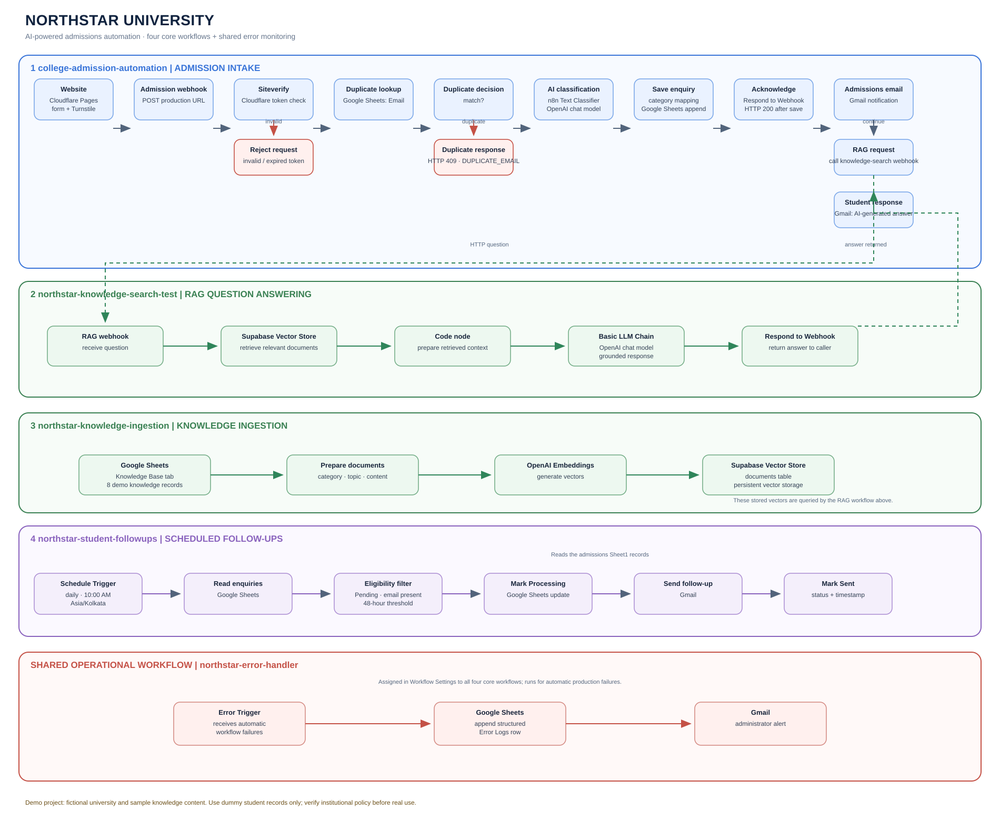

# Northstar University — AI-Powered Admissions Automation

> **Portfolio demo project.** Northstar University is a fictional university used to demonstrate an AI-assisted admissions workflow. The programme, fees, scholarship and deadline content is sample knowledge-base material and must not be represented as verified institutional policy.

**Live demo:** [northstar-university-website.pages.dev](https://northstar-university-website.pages.dev/)  
**Source repository:** [Saisharad8055/northstar-university-website](https://github.com/Saisharad8055/northstar-university-website)

Northstar University is a static admissions website connected to a set of n8n workflows. A student can submit an enquiry, complete Cloudflare Turnstile verification, and receive an acknowledgement. The workflows check for duplicate email addresses, classify the enquiry, save it to Google Sheets, notify the admissions inbox, and use retrieval-augmented generation (RAG) to prepare a knowledge-grounded response. A scheduled workflow handles follow-up emails, while a shared error workflow records production failures and notifies an administrator.

## Contents

- [Project goals](#project-goals)
- [Features](#features)
- [Architecture](#architecture)
- [Workflow breakdown](#workflow-breakdown)
- [Technology stack](#technology-stack)
- [Repository structure](#repository-structure)
- [How to run the website locally](#how-to-run-the-website-locally)
- [n8n and service configuration](#n8n-and-service-configuration)
- [Google Sheets structure](#google-sheets-structure)
- [Security and privacy](#security-and-privacy)
- [Testing checklist](#testing-checklist)
- [Known limitations and future improvements](#known-limitations-and-future-improvements)
- [Useful documentation](#useful-documentation)

## Project goals

1. Provide a clean, responsive admissions enquiry experience.
2. Automate the routing and recording of new enquiries.
3. Use AI classification to identify the type of question being asked.
4. Ground AI-generated answers in a university knowledge base rather than inventing fees, eligibility rules or deadlines.
5. Follow up with eligible students after a configured waiting period.
6. Capture workflow failures centrally so an administrator can investigate them.

## Features

- **Responsive static website:** HTML, CSS and vanilla JavaScript; no frontend framework or application server is required.
- **Bot verification:** Cloudflare Turnstile widget in the browser, with server-side token validation through Cloudflare Siteverify.
- **Duplicate-email check:** Looks up the submitted email in the admissions spreadsheet before creating a new record. Duplicate submissions return an HTTP `409` response with a `DUPLICATE_EMAIL` code.
- **AI enquiry classification:** An n8n Text Classifier routes enquiries into categories such as Fees & Scholarships, Eligibility & Documents, Application Process, Programme Information, Admission Deadlines, General Enquiry and Other.
- **Structured enquiry storage:** New enquiries are recorded in Google Sheets with the classification result and submission timestamp.
- **Admissions notification:** The admissions inbox is notified after the enquiry is recorded. This notification is placed before RAG processing so a later RAG failure does not prevent the admissions team from being notified.
- **Knowledge-grounded answers:** A separate RAG workflow retrieves relevant content from the Supabase Vector Store and passes it to an OpenAI chat model. The prompt instructs the model not to invent missing policy details and to identify demo/unverified information.
- **Automated follow-ups:** A scheduled workflow checks eligible `Pending` records after the configured 48-hour threshold. It marks a record `Processing` before sending and `Sent` with a timestamp after a successful send.
- **Central error monitoring:** A shared n8n Error Trigger workflow appends execution details to an `Error Logs` sheet and sends an administrator email.
- **Git-based deployment:** Cloudflare Pages deploys the static site from GitHub when changes are pushed to the connected production branch.

## Architecture



The system has **four core workflows** and **one shared operational error workflow**:

1. `college-admission-automation` — admission intake, verification, duplicate checking, classification, storage and notifications.
2. `northstar-knowledge-search-test` — accepts a question, retrieves relevant vector-store documents and generates a grounded answer. The workflow name retains `-test` from development; use the published production webhook URL when calling it from the admission workflow.
3. `northstar-knowledge-ingestion` — prepares knowledge-base content, generates embeddings and stores documents in Supabase.
4. `northstar-student-followups` — scheduled follow-up processing for eligible enquiries.
5. `northstar-error-handler` — shared Error Trigger workflow assigned to the core workflows for central logging and email alerts.

### Request and response path

```text
Browser (Cloudflare Pages)
  └─ Admission form + Turnstile token
       └─ n8n admission webhook
            ├─ Cloudflare Siteverify
            ├─ Duplicate email lookup (Google Sheets)
            ├─ Text Classifier (OpenAI)
            ├─ Append enquiry (Google Sheets)
            ├─ Respond to browser (HTTP 200)
            ├─ Notify admissions inbox (Gmail)
            ├─ Call RAG webhook (HTTP Request)
            └─ Send grounded answer to student (Gmail)
```

The browser acknowledgement is sent after the enquiry is saved. The later notification and AI-response steps continue in the workflow. If a downstream step fails, the shared error workflow records the failure. A RAG failure does not undo the saved enquiry or the admissions notification; the student AI-response email is not sent if the RAG step fails.

## Workflow breakdown

### 1. Admission intake — `college-admission-automation`

**Trigger:** Production Webhook called by the website.

**Main path:**

1. Receive the form submission and Turnstile response token.
2. Call Cloudflare Siteverify using the secret stored in n8n credentials.
3. Reject the request if verification fails.
4. Look up the submitted email in the admissions sheet.
5. Return a duplicate response (`409`, `DUPLICATE_EMAIL`) when a matching record exists.
6. Send new enquiries to the n8n Text Classifier, connected to an OpenAI chat model.
7. Map the category-specific output into the admissions record fields.
8. Append the enquiry and category to Google Sheets.
9. Return a success response to the website once the record is saved.
10. Notify the admissions inbox, call the RAG workflow, and send the generated answer to the student.

**Failure behaviour:** An automatic production execution failure invokes the shared error workflow. The admissions row and admissions notification are performed before the RAG request, which reduces the chance that an AI service failure hides a received enquiry.

### 2. Knowledge ingestion — `northstar-knowledge-ingestion`

**Purpose:** Move the university's curated knowledge content into persistent vector storage for semantic retrieval.

The source knowledge is maintained in a Google Sheets tab with `Category`, `Topic`, `Knowledge Content` and `Status` columns. The demo knowledge base contains eight sample knowledge records. The ingestion workflow prepares documents, generates embeddings through an OpenAI embeddings connection and inserts them into the Supabase Vector Store (the configured table is `documents`).

The `Status` field is important: records marked `Demo - Needs Verification` are not verified university policy. Keep the content clearly labelled as demo information until replaced by approved material.

### 3. RAG question answering — `northstar-knowledge-search-test`

**Trigger:** Webhook called by the admission workflow's HTTP Request node.

**Main path:**

1. Receive the student's question.
2. Retrieve relevant documents from the Supabase Vector Store.
3. Prepare the retrieved context in a Code node.
4. Pass the question and retrieved knowledge to a Basic LLM Chain using an OpenAI chat model.
5. Return the answer to the calling workflow through Respond to Webhook.

The system prompt instructs the model to answer using retrieved knowledge, not invent fees, eligibility rules or deadlines, and clearly state when information is missing or unverified. For example, if no confirmed application deadline is in the retrieved knowledge, the answer should say that no confirmed deadline is available and direct the student to the admissions team.

### 4. Scheduled follow-ups — `northstar-student-followups`

**Trigger:** Schedule Trigger configured for a daily run at 10:00 AM in `Asia/Kolkata`.

**Main path:**

1. Read admissions rows from Google Sheets.
2. Filter eligible records in a Code node. The configured waiting threshold is 48 hours; records must also meet the workflow's status/email checks.
3. Update the selected row to `Processing` before attempting the email.
4. Send the follow-up email through Gmail.
5. Update the row to `Sent` and record the follow-up timestamp.

The intermediate `Processing` status helps prevent the next scheduled run from sending the same follow-up again while an earlier attempt is unresolved. A record left in `Processing` after a send failure requires review before a manual retry; the workflow does not prove recipient delivery merely because the Gmail node accepted a send request.

### Shared operational workflow — `northstar-error-handler`

The Error Trigger receives details when an assigned automatic workflow execution fails. It appends a structured record to the `Error Logs` tab and sends an administrator email.

Logged fields include timestamp, workflow name and ID, execution ID, failed node, error message, execution URL and execution mode. The shared handler is assigned in Workflow Settings to the core workflows. n8n documents that Error Trigger workflows run for automatic execution failures, not manual editor runs; see [n8n error handling](https://docs.n8n.io/flow-logic/error-handling/) and [Error Trigger node](https://docs.n8n.io/integrations/builtin/core-nodes/n8n-nodes-base.errortrigger/).

## Technology stack

| Layer | Technology | Role |
|---|---|---|
| Frontend | HTML5, CSS3, vanilla JavaScript | Responsive admissions website and form submission |
| Static hosting / CI | Cloudflare Pages, GitHub | Public HTTPS hosting and Git-based deployments |
| Bot protection | Cloudflare Turnstile | Browser challenge and server-side token validation |
| Workflow orchestration | n8n Cloud | Webhooks, branching, scheduling and service integrations |
| AI classification | n8n Text Classifier + OpenAI chat model | Enquiry category routing |
| Generative AI | OpenAI chat model | Context-grounded question answering |
| Embeddings | OpenAI embeddings | Convert knowledge content and queries into vectors |
| Vector database | Supabase Vector Store | Persistent storage and retrieval of embedded knowledge |
| Operational data | Google Sheets | Enquiries, knowledge-base records and error logs |
| Email | Gmail | Admissions notifications, student responses and follow-ups |

## Repository structure

The website repository is a static frontend. The n8n workflows and their credentials are configured in n8n Cloud rather than stored in this website repository.

```text
northstar-university-website/
├── index.html              # Website markup, styles and client-side form logic
├── .gitignore              # Excludes local and secret-bearing files
├── README.md               # Project documentation
└── docs/
    ├── architecture.svg    # Scalable workflow architecture diagram
    ├── architecture.png    # PNG preview of the diagram
    └── architecture.mmd    # Editable Mermaid source for the diagram
```

If the project later gains separate CSS, JavaScript, screenshots or workflow export files, add them to the repository and update this tree. Do not commit credential exports or secrets.

## How to run the website locally

### Prerequisites

- Git
- Visual Studio Code
- A local static server such as the VS Code Live Server extension
- Access to the configured n8n instance for backend workflow testing

### Run

```bash
git clone https://github.com/Saisharad8055/northstar-university-website.git
cd northstar-university-website
```

Open the folder in VS Code and serve `index.html` with Live Server.

### Local Turnstile testing

The deployed site uses a production Turnstile sitekey restricted to the Pages hostname. That production widget is not expected to work on `127.0.0.1` or `localhost` unless those hostnames are explicitly allowed for that widget. For local development, create a separate Turnstile development widget with the local hostname allowed and use its matching test/development secret in a non-production n8n setup. Do not put a Turnstile secret in browser code.

### Configure the admission webhook

The frontend submits the form to the n8n admission webhook. In `index.html`, configure the `WEBHOOK_URL` constant to the appropriate **production** webhook URL for the deployed site, or a dedicated test webhook for local development. The public webhook URL is not a secret, but the endpoint must validate requests and tokens server-side.

## n8n and service configuration

The n8n workflows are not included as importable JSON exports in this repository. The following is a configuration guide for recreating or reviewing the workflows in an n8n workspace.

### Credentials to configure in n8n

- Google Sheets OAuth credential with access to the admissions spreadsheet.
- Gmail OAuth credentials for the admissions/admin inbox and the sender used for student messages.
- OpenAI credentials for the chat model and embeddings model.
- Supabase credential for the vector-store table.
- Cloudflare Turnstile secret for the Siteverify request.

Keep credentials in n8n's credential store. Never paste secret keys into `index.html`, client-side JavaScript, GitHub, this README or screenshots.

### Cloudflare Pages and CORS

The deployed site is hosted at `https://northstar-university-website.pages.dev`. Configure the admission Webhook node's allowed CORS origin to that exact origin (no path or trailing slash). For a separate local development setup, allow the exact local origin there as well. CORS is a browser policy, not authentication; it does not replace Turnstile verification or server-side validation.

Cloudflare Pages Git integration can automatically deploy commits pushed to the connected GitHub branch. See [Cloudflare Pages Git integration](https://developers.cloudflare.com/pages/configuration/git-integration/).

### Turnstile verification

The browser embeds the public Turnstile **sitekey**. The n8n Siteverify HTTP Request uses the private **secret** and the `cf-turnstile-response` token from the Webhook body. Validate the token server-side on every submission. Cloudflare documents the client widget and server-side Siteverify flow in its [Turnstile getting started guide](https://developers.cloudflare.com/turnstile/get-started/). Tokens are single-use and expire after five minutes; see [token validation](https://developers.cloudflare.com/turnstile/turnstile-analytics/token-validation/).

### Supabase vector storage

Enable the PostgreSQL `vector` extension and configure the vector table to match the embedding model's dimensions and the n8n Supabase Vector Store node configuration. The project used a `documents` table. See [Supabase vector columns](https://supabase.com/docs/guides/ai/vector-columns).

## Google Sheets structure

The project uses separate tabs for distinct data responsibilities.

### `Sheet1` — admission enquiries

The sheet includes student/contact details, programme and qualification, the original message, submission timestamp, enquiry category, follow-up status and follow-up sent timestamp. The `row_number` value used by n8n is a row reference from the Sheets node, not a student-facing column that should be manually typed.

### `Knowledge Base` — source content for RAG

| Column | Purpose |
|---|---|
| Category | Broad knowledge category |
| Topic | Specific topic within the category |
| Knowledge Content | Text supplied to the ingestion workflow |
| Status | Verification state, e.g. `Demo - Needs Verification` |

The demo source includes eight records across programme information, application process, eligibility and documents, fees and scholarships, admission deadlines and general enquiries.

### `Error Logs` — workflow failures

| Column | Purpose |
|---|---|
| Logged At | Time the failure was recorded |
| Workflow Name | Failed workflow |
| Workflow ID | n8n workflow identifier |
| Execution ID | Failed execution identifier |
| Failed Node | Last node reported as executed |
| Error Message | Failure details |
| Execution URL | Link to the execution in n8n |
| Execution Mode | For example, `webhook` |

## Security and privacy

- **Never expose secrets:** Turnstile secret, Supabase service-role key, OpenAI API key, Google OAuth tokens and other private credentials belong in server-side credential storage, not the frontend or Git repository.
- **Sitekey versus secret:** The Turnstile sitekey is public and belongs in the browser; the secret belongs only in n8n and is used for Siteverify.
- **Validate server-side:** Never trust a browser-provided success state. n8n must validate the Turnstile token with Siteverify.
- **Use least privilege:** Give the Cloudflare GitHub App access only to the website repository where possible, and limit Google/Supabase credentials to required resources.
- **CORS is not access control:** Restrict allowed origins, but do not treat that as authentication.
- **Demo data only:** Use fictional student details during demonstrations. Do not collect real student personal information without an appropriate privacy notice, consent, access controls, retention policy and institutional approval.
- **Demo claims:** Northstar University is fictional. Do not present the sample knowledge base as verified policy, and do not imply that the site is accepting real admissions applications.
- **Follow-up safety:** Review records left in `Processing` after a failed send before retrying, to avoid duplicate emails.

## Testing checklist

- [ ] Open the deployed Pages URL and confirm the website loads over HTTPS.
- [ ] Complete Turnstile on the allowed production hostname.
- [ ] Submit a new dummy email and confirm one row is appended.
- [ ] Confirm the website receives the success response after the row is saved.
- [ ] Confirm the admissions notification is sent.
- [ ] Confirm the RAG answer is grounded in retrieved knowledge and does not invent missing details.
- [ ] Confirm the student response email is sent when RAG succeeds.
- [ ] Submit the same email again and confirm HTTP `409` / `DUPLICATE_EMAIL`, with no new row.
- [ ] Simulate a downstream RAG failure and confirm the existing enquiry remains saved, the admissions notification has already run, and the central error workflow logs the failure.
- [ ] Confirm the follow-up workflow's timezone and schedule; inspect eligible rows before enabling it for any real recipients.
- [ ] Review the Git repository for accidental secrets before sharing it publicly.

## Known limitations and future improvements

- The knowledge base is intentionally small (eight demo records) and marked as unverified. Add approved, versioned institutional content before any real use.
- The RAG workflow returns one answer from retrieved context; it is not a fully autonomous agent with independent planning, long-running memory or an agent decision loop.
- If RAG fails after the admission row and acknowledgement are completed, the enquiry is retained and the admissions team is notified, but the student AI-response email is skipped. A future enhancement could queue the unanswered response for retry or human review.
- A follow-up row left in `Processing` after an ambiguous email outcome requires manual review. A future enhancement could add idempotency keys, delivery tracking and a safe recovery workflow.
- The current demo uses Google Sheets for operational records. A production system with larger volumes may benefit from a transactional database, stricter access control and audit retention.
- Add automated tests for duplicate matching, token rejection, response status codes, and follow-up state transitions.
- Consider adding rate limiting and abuse monitoring to the public webhook, plus structured application-level metrics.
- Export and version-control sanitized n8n workflow definitions separately if the workflows need to be reproducible. Remove credential data before exporting or sharing.

## Useful documentation

- [n8n documentation](https://docs.n8n.io/)
- [n8n error workflows](https://docs.n8n.io/flow-logic/error-handling/)
- [n8n Error Trigger node](https://docs.n8n.io/integrations/builtin/core-nodes/n8n-nodes-base.errortrigger/)
- [Cloudflare Pages Git integration](https://developers.cloudflare.com/pages/configuration/git-integration/)
- [Cloudflare Turnstile setup](https://developers.cloudflare.com/turnstile/get-started/)
- [Cloudflare Turnstile token validation](https://developers.cloudflare.com/turnstile/turnstile-analytics/token-validation/)
- [Supabase vector columns](https://supabase.com/docs/guides/ai/vector-columns)

---

**Project status:** Deployed demo / portfolio project. Use fictional data only.
